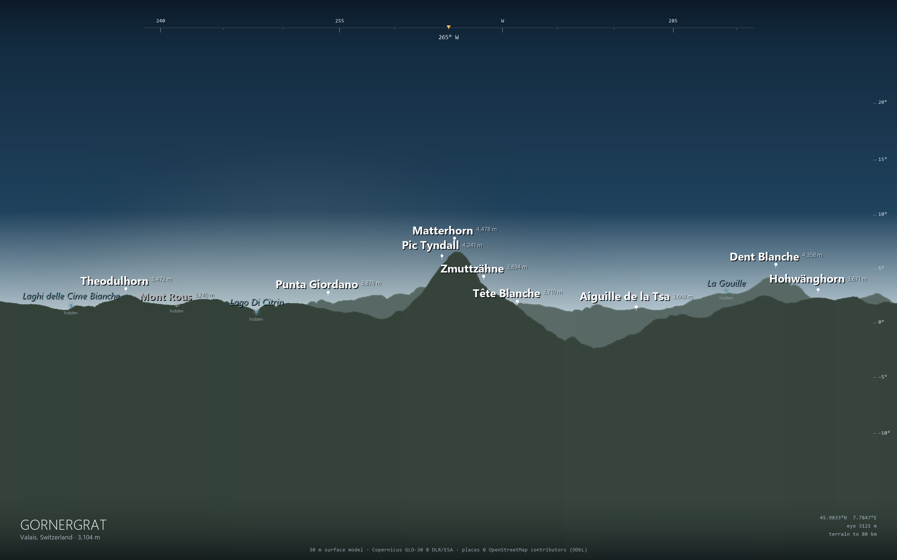
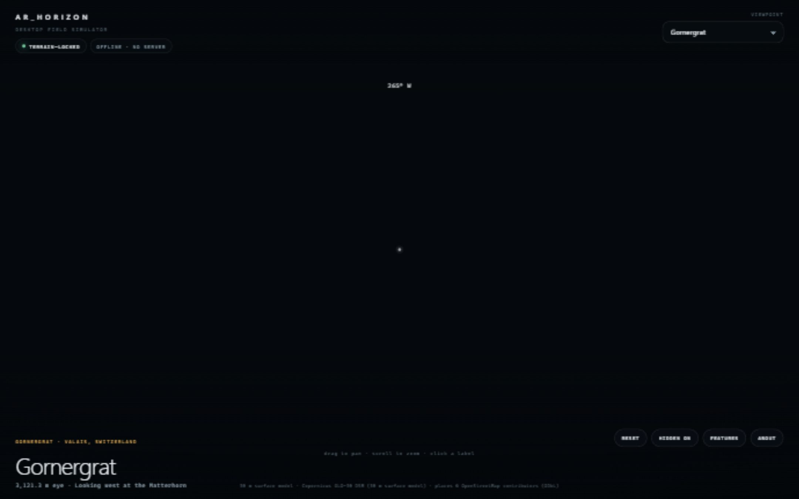

# AR_Horizon

**Point your phone at a view. Every peak, town, village, lake and landmark you can actually see gets a name, distance and elevation — pinned to the terrain, offline.**

This repository is a working vertical slice of the design in
`~/.opencode/plan/vantage-ar-horizon-design.md`: a portable terrain core, a
Python M0 panorama renderer, a real Copernicus GLO-30 pack of the Matterhorn
region, an Android + ARCore app, and an optional pack service.

**It is standalone by default and costs 0 € to run.** The APK ships with the
Alps pack and the worldwide city index; first launch needs no network and no
server. Add regions by importing a `.sqlite` pack from the phone's storage or a
direct HTTPS link. The FastAPI service is optional, local-only tooling.



*M0 golden: Gornergrat, 3,104 m, looking 265° at the Matterhorn. Rendered from
the same pack and the same 3,600-bin silhouette the phone uses. Matterhorn at
265.6°, +7.9°, 9.8 km. Hidden places are dimmed on the ridge, not faked into view.*

---

## What is in the box

| Piece | What it does | State |
|---|---|---|
| `core/` | C++17 terrain core: bilinear DEM sampling, 3,600-bin horizon with curvature and refraction, visibility, projection, declutter, skyline correlation. C ABI + JNI. | builds and passes 39 native checks |
| `tools/` | Copernicus download, Overpass places, pack builder, worldwide index builder, M0 PNG renderer, tests. | Working; produced the pack and the image above |
| `android/` | Kotlin + Compose + ARCore app: OES camera preview, sensor fusion, manual drag alignment, terrain labels, hidden labels, list mode, pack manager, photo export, attribution. | `assembleDebug` produces an installable APK |
| `web/` | Desktop field simulator: same pack, horizon and label rules, no phone and no server. | open `web/index.html` |
| `server/` *(optional)* | FastAPI catalogue, manifests, resumable pack downloads, coverage query, honest 501 for unmounted on-demand assembly. | 5 tests pass; not needed to run the app |

The bundled pack is **Alps: Matterhorn and Monte Rosa** — 80 km radius around
Gornergrat, 30 m GLO-30 terrain, 7,955 OSM peaks/settlements/lakes/landmarks,
51 MB. It contains real data, not a mock.

---

## Quick start (Windows)

### 1. Python side (renderer, pack factory, tests)

```powershell
python -m venv .venv
.\.venv\Scripts\python.exe -m pip install -r tools\requirements.txt

# The pack and golden are already committed. To rebuild them:
.\.venv\Scripts\python.exe tools\fetch_places.py --lat 45.98331 --lon 7.78470 --radius 85
.\.venv\Scripts\python.exe tools\build_pack.py `
  --lat 45.98331 --lon 7.78470 --radius 80 `
  --name "Alps: Matterhorn and Monte Rosa" --id alps-matterhorn `
  --places data/places/alps.json `
  --out android/app/src/main/assets/packs/alps.pack.sqlite
.\.venv\Scripts\python.exe tools\build_world_index.py
.\.venv\Scripts\python.exe tools\render_golden.py
```

Copernicus tiles are ~42 MB each and land in `data/cache/dem/`; they are
downloaded once. Overpass responses are cached in `data/cache/places/`.

### 2. Native core

The portable core has no third-party dependencies.

```powershell
core\build_windows.bat          # MSVC: vantage-cli.exe + vantage-tests.exe
core\build\vantage-tests.exe    # 39 checks, 0 failures
core\build_core_dll.bat         # MSVC: DLL for the synthetic skyline lock test

android\build_native.ps1        # Windows NDK: arm64-v8a + x86_64
bash android/build_native.sh    # Linux/macOS NDK (used by GitHub CI)
```

`core/CMakeLists.txt` also works with CMake/CTest if you prefer.

### 3. Android APK

```powershell
$env:JAVA_HOME = "C:\Users\<you>\.jdks\temurin-21"
$env:ANDROID_HOME = "$env:LOCALAPPDATA\Android\Sdk"
cd android
.\gradlew.bat :app:assembleDebug
```

Output: `android/app/build/outputs/apk/debug/app-debug.apk` (~84 MB debug,
including the 51 MB pack and ARCore). Or run `.\build_apk.ps1` to build the
native libs and APK in one step. A copy is in `dist/AR_Horizon-0.1.0-debug.apk`.
Install with `adb install -r dist\AR_Horizon-0.1.0-debug.apk`.

The app works without a camera: it draws the same silhouette as a compass
panorama. That is also the emulator path. ARCore adds the camera and the
skyline lock.

### GitHub CI and APK artifacts

Two workflows are included:

- **`.github/workflows/ci.yml`** runs the C++ suite, Python/service tests and
  the web JS check, then installs Android SDK 36 + NDK r27c, builds the JNI
  libraries, assembles and lints the APK, and uploads
  `AR_Horizon-debug-apk` as a workflow artifact.
- **`.github/workflows/pages.yml`** publishes the static `web/` simulator to
  GitHub Pages on pushes to `main`/`master` (enable **Pages → Source: GitHub
  Actions** once in the repository).

No signing secrets are required for CI; the artifact is a debug-signed,
installable APK. For a release keystore, build locally with the release
keystore configured in Android Studio/Gradle.

### 4. Desktop build (no phone)

```powershell
Start-Process web\index.html       # zero server, from file://
# or
web\serve.ps1                      # http://127.0.0.1:8099
```

The desktop field simulator has four viewpoints, drag-to-pan, scroll-to-zoom,
clickable labels, hidden-label toggle, feature list and attribution. It uses the
same pack and 3,600-bin horizon as the phone. See
[docs/DESKTOP.md](docs/DESKTOP.md).



The skyline lock also has a no-camera test:

```powershell
core\build_core_dll.bat
.\.venv\Scripts\python.exe tools\validate_skyline_lock.py
```

It builds synthetic camera frames from the DEM, extracts the sky/terrain
boundary with the same sampler as Android, and calls the same C++ fit. It
recovers injected yaw errors of ±3–8° to within 0.1° with a score above 0.94.
Proof: `docs/goldens/skyline-lock.png`.

### 5. Optional pack service (not needed to use the app)

```powershell
server\prepare.ps1
server\run.ps1            # http://127.0.0.1:8000
```

The app ships with no catalogue URL. That is deliberate: it never needs a
server. If you want the LAN catalogue for development, set it in
**Terrain → Catalogue server (optional)** to `http://10.0.2.2:8000` on the
emulator or your PC's LAN address on a phone.

For a zero-cost public distribution, skip the server entirely:

- **File import** — copy a pack `.sqlite` to the phone (USB, Downloads, SD card)
  and use **Terrain → Import .sqlite**. No network, no account.
- **Direct URL** — upload packs to any free static host (GitHub Releases,
  Cloudflare R2/Pages free tier, your own web space) and paste the direct file
  URL into **Terrain → Direct pack URL**.
- **Bundled** — the Alps pack and world index are inside the APK.

The optional FastAPI service is just a small catalogue/download wrapper for
local development; it is not required for any app feature.

---

## Verified numbers

These are measured, not aspirations:

| Check | Result |
|---|---|
| Matterhorn from Gornergrat | bearing **265.6°**, elevation **+7.9°**, distance **9.8 km** |
| C++ vs Python silhouette, all 3,600 bins | max difference **0.00005°**, mean 0.000024° |
| Portable core silhouette, desktop i9 | **15.3 ms** avg, 16.8 ms worst (target < 15 ms) |
| Horizon range in the bundled pack | **80.1 km** |
| Native tests | 39 checks, 0 failures |
| JNI surface | host smoke test: terrain → silhouette → labels → skyline fit, passed |
| Synthetic skyline lock | **5/5** injected yaw errors recovered, max error 0.10°, score > 0.94 |
| Python tests | 12 passed |
| Server tests | 5 passed |
| Gornergrat golden | 13 labels in a 72° field, Matterhorn and the Zmutt ridge |

A second golden looks north-east from the same point:
`docs/goldens/gornergrat-village.png` (16 labels, including three hidden places
dimmed on the ridge).

The golden is checked into `docs/goldens/gornergrat.json` with every label's
bearing, elevation and distance.

---

## How it works

```
 camera + IMU ──▶ pose fusion ──▶ projection ──▶ label solver ──▶ labels
                     ▲                ▲
 compass prior ──────┘                │
 skyline lock ───────┘          silhouette[3600]
                                      ▲
 terrain pack ──▶ DEM sampler ────────┘
 places pack  ────────────────────────┘
```

- **Terrain.** Packs store 1" Int16 tiles (600×600, aligned to whole degrees)
  plus 4" mips, zstd-compressed in SQLite. The app assembles a 30 km fine window
  and an 80 km coarse window, hands both to C++, and the core samples fine
  inside 30 km and coarse beyond.
- **Horizon.** Per 0.1° bin the core marches a piecewise distance schedule,
  tracking `atan2(h − eye − d²/(2·R_eff), d)` with `R_eff = 6371 km/(1−0.13)`.
  A global max-height early exit keeps it under ~1 M samples.
- **Pose.** ARCore supplies a gravity-aligned relative pose. The rotation-vector
  compass plus `GeomagneticField` declination seeds absolute north, gated on
  high accuracy. Nothing steers labels from the compass after the seed. A drag
  adds a session offset. The skyline lock correlates the camera's sky/terrain
  boundary against the synthetic horizon and applies a median-of-5 correction,
  capped at 0.5° per update.
- **Labels.** Core ranks by type, population, pack rank and proximity; tests
  screen boxes; caps at 35; only opacity changes in the UI, so nothing jitters.
  A target above `silhouette[az] + 0.03°` is visible; below it is "hidden" and
  drawn dimmed on the skyline.
- **Index mode.** A 1 MB worldwide GeoNames cities15000 index plus curated and
  packed peaks gives bearing/distance/elevation with no terrain. The UI says
  **approximate** instead of pretending visibility is known.

Full details: [docs/ARCHITECTURE.md](docs/ARCHITECTURE.md),
[docs/DESKTOP.md](docs/DESKTOP.md), [docs/STANDALONE.md](docs/STANDALONE.md),
[docs/DATA.md](docs/DATA.md), [docs/FIELD-TESTING.md](docs/FIELD-TESTING.md).
The latest audit is in [docs/CODE-REVIEW.md](docs/CODE-REVIEW.md).

---

## What is deliberately not finished

This is a strong M0–M5 slice, not a shipped v1. Honest gaps:

- **On-demand worldwide assembly.** The global 1° tile set (~150 GB compressed),
  the queue, the cache-by-content-hash and the top-200 pre-built packs are not
  in this repo. The service serves one real pack and returns a clear 501 for
  regions it cannot assemble. The pack format and builder are the seam.
- **Field validation.** No physical ARCore phone was available. The maths, pack
  and APK are verified, and the skyline lock recovers synthetic yaw errors to
  within 0.1°; real camera exposure, motion blur, ARCore timing and the compass
  seed outdoors are not tested. The test protocol is written up but unrun.
- **Photo export** is a composited window capture, not a 1080p
  `acquireCameraImage` re-projection with image intrinsics. It includes the
  labels and burns the attribution; it is not the design's high-resolution
  re-render yet.
- **Marks** (long-press personal pins) are not implemented.
- **Barometer smoothing** is not wired; eye altitude is DEM + the eye-height
  setting only.
- **Worldwide peaks.** The bundled peak index is curated plus the Alps pack.
  A full OSM/Wikidata peak build is the planet pipeline's job.
- **Tile size** is 600×600 rather than the design's 512×512 because 600 divides
  3,600 arc-seconds into whole-degree COGs, so tiles align without resampling.
  Same format, cleaner provenance.
- **ABI** is 64-bit only (`arm64-v8a`, `x86_64`) for v1.
- **China, iOS, lidar packs** — not addressed.

The app's **Terrain → Sources and licences** screen states the 30 m surface
model limits in the product, not just the docs.

---

## Repository map

```
core/                  portable C++17 core, CLI, native tests, JNI
  include/vantage_core.h   public C ABI
  src/core.cpp             geodesy, terrain, silhouette, solver, skyline fit
  jni/vantage_jni.cpp      JNI bridge used by Android
web/                   desktop field simulator (no phone, no server)
.github/workflows/     CI (tests + APK artifact) and GitHub Pages
android/               Kotlin + Compose + ARCore app
  app/src/main/java/app/vantage/
    ar/                    ARCore session, OES renderer, skyline sampler
    data/                  pack SQLite reader, terrain assembly, index
    engine/                terrain session, pose fusion, label loop
    sensors/               compass, location
    ui/                    AR, list, packs, info card, attribution
tools/                 Python pack factory, renderer, index builder, tests
server/                FastAPI pack service + tests
docs/                  architecture, standalone/0€, data, field protocol, goldens, review
data/                  caches and intermediate goldens (mostly generated)
```

---

## Licences

Code in this repository is MIT (see `LICENSE`). Data is not:

- **Copernicus GLO-30** — © DLR e.V. 2010–2014 and © Airbus Defence and Space
  GmbH 2014–2018, provided under COPERNICUS by the EU and ESA. Attribution is
  shown in-app and in every pack manifest.
- **OpenStreetMap** — © OpenStreetMap contributors, ODbL 1.0. The derived
  places database in a pack is offered under ODbL; see
  [docs/ATTRIBUTION.md](docs/ATTRIBUTION.md).
- **GeoNames** — CC BY 4.0.
- **Wikipedia / Wikidata** — CC BY-SA 4.0; linked, never bundled as long text.

AR_Horizon is the product name. Check trademark and store availability before
release.
